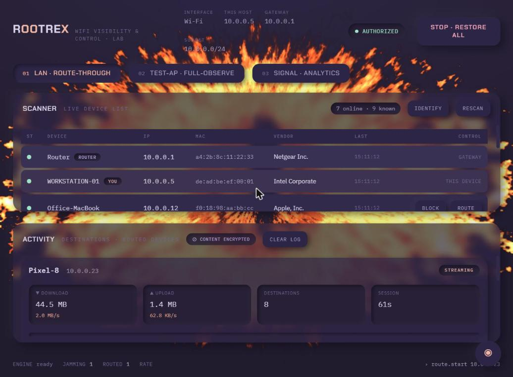
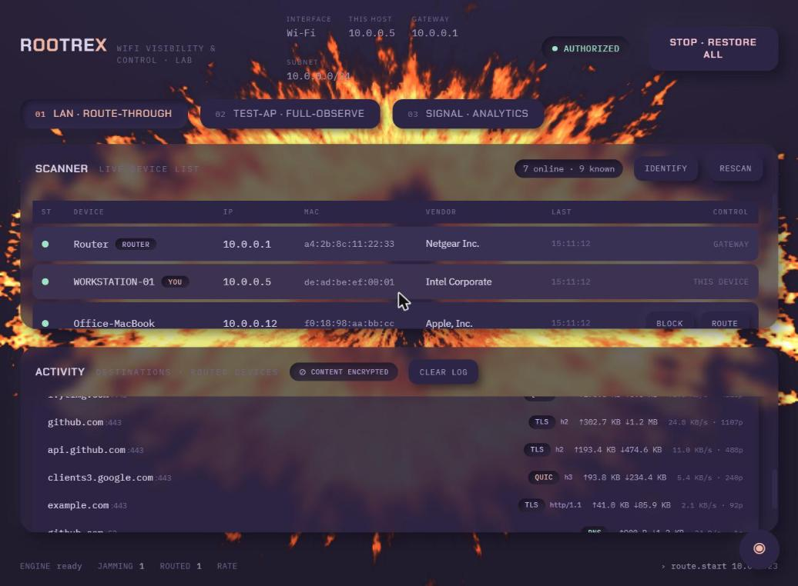

<div align="center">


# RootreX

### WiFi Network Visibility &amp; Control
**A consented, lab-scoped security demonstration tool for Windows.**

[](LICENSE) &nbsp;
[](#requirements--setup) &nbsp;
[](https://www.python.org/) &nbsp;
[](#%EF%B8%8F-consent--scope--read-before-running)

*See where devices go on a network you're authorized on — and exactly where that visibility stops.*

</div>

---

> **⚠️ Authorized, consented, lab use only.** RootreX manipulates ARP and reads traffic **metadata** on networks you own or are explicitly authorized to test, against devices whose owners have consented. Anything else is illegal in most jurisdictions and is on you, not the tool. It **never** decrypts content, injects deauthentication frames, or impersonates networks you don't own.

**Contents:** [What it does](#what-it-does) · [Screenshots](#screenshots) · [Scope boundary](#scope-boundary--what-rootrex-will-not-do) · [Install](#install-build--distribute-windows) · [Architecture](#architecture--stack) · [The attacks, explained](#the-explained-attacks-not-executed) · [Security](SECURITY.md) · [License](#license)

<div align="center">
<br>

<br><sub><i>Live device list + per-device destination activity. <b>Illustrative demo data — not a real network.</b></i></sub>
</div>

RootreX is a teaching instrument. It shows, on a network you are authorized on and against devices whose owners have agreed, two things that every network defender needs to understand first-hand:

1. **How Layer-2 trust is abused** — ARP cache manipulation to cut a device off its gateway, or to route its traffic through your machine (the mechanism behind "NetCut"-style tools and every on-path MITM).
2. **What a man-in-the-middle can and cannot see** — the destinations a device reaches (plaintext DNS, and the TLS SNI during the handshake), and, just as importantly, the hard wall where visibility stops: **encrypted payload content is never readable**, and RootreX draws that boundary explicitly in its UI rather than hiding it.

It is deliberately *not* a weapon. The attacks that only make sense against people who never agreed — deauthentication flooding and evil-twin impersonation of a network you don't own — are **documented in full but never executed** (see [The explained attacks](#the-explained-attacks-not-executed)).

---

## ⚠️ Consent & scope — read before running

RootreX is for **authorized use in a controlled lab only**. By running it you assert that:

- You **own or are explicitly authorized to test** the network in question.
- Every device you target belongs to someone who has **consented** to the demonstration.
- You are using it to **learn and to defend**, not to surveil or disrupt anyone.

RootreX enforces this in software, not just on paper:

- A **consent gate** on launch — nothing transmits until you confirm authorization for this session.
- A **target allowlist** — you cannot jam or route a device you have not explicitly added. There is no "select everyone and cut."
- **Bulletproof restore** — every ARP entry RootreX touches is tracked and restored on exit, crash, or the always-visible **STOP · RESTORE ALL** control. No device is left broken.
- **Loopback-only API** — the control plane binds to `127.0.0.1`; nothing is exposed on the network.
- **No content capture** — RootreX records destinations and metadata, never payload bytes.

Running ARP spoofing or traffic interception against networks or devices without authorization is illegal in most jurisdictions. That is on you, not the tool.

---

## What it does

| Mode | What you see | How traffic reaches you |
|------|--------------|-------------------------|
| **LAN / Route-through** *(main)* | Live device list on your network (IP · MAC · vendor · first/last seen). Per-device **Block / Unblock** and **Route-through**. For routed devices: the **domains they visit** (DNS + TLS-SNI). | ARP cache manipulation — you become the device's gateway on-path. No access to the target device needed; you only need to be on the same L2 network. Runs on your **router/LAN** (primary) or when you're a client of a **phone hotspot**. |
| **Test-AP / Full-Observe** | Devices that join *your own* access point, and the **full per-device metadata board**: destination IPs, resolved org/domain, ports, connection counts, packet sizes & timing, grouped per device — with the TLS content boundary drawn in the UI. | Your laptop *is* the gateway (Windows Mobile Hotspot with your chosen SSID/password). Traffic transits your machine **natively — no spoofing at all**. Devices join deliberately. |

Both modes share one Observer and one honesty rule: **you can see *where*, never the encrypted *what*.**

---

## Screenshots

> **Illustrative demo data — a fake `10.0.0.x` network with invented devices. Not a real capture.**

<table>
<tr>
<td width="50%" valign="top">

<br><sub><b>Destination visibility.</b> Per-device domains, protocol (TLS / QUIC·h3 / DNS), bytes up/down — with the <b>⊘ content encrypted</b> boundary drawn explicitly. Hostnames, never payload.</sub>
</td>
<td width="50%" valign="top">

<br><sub><b>Collapse-to-eye view.</b> One click hides every panel, leaving the ambient background — a procedural WebGL flame eye on the bottom layer.</sub>
</td>
</tr>
</table>

---

## Scope boundary — what RootreX will not do

These are excluded by design. They are explained in [the writeup](#the-explained-attacks-not-executed) so you understand and can defend against them, but there is no code path that performs them:

- **No deauthentication frame injection.** RootreX never forces a device off any access point.
- **No evil-twin impersonation of a network you don't own.** The Test-AP module stands up *your own* AP that devices join deliberately. It does not scan for nearby networks to clone, and it does not auto-capture anyone.
- **No TLS / HTTPS content decryption.** RootreX reads the clear parts of a handshake (SNI) and plaintext DNS. It never terminates, strips, or decrypts TLS.

If you need to study those attacks, read the writeup and stand up an isolated lab with gear you own. RootreX gives you the defender's view of them: how they work, why they succeed, and how modern standards stop them.

---

## Architecture & stack

One Python process runs the network engine and a loopback API, opens the UI in your default browser, and sits in the system tray.

```
            ┌──────────── RootreX UI in your browser · system-tray control ───────────┐
            │   Tactical HUD (vanilla JS + GSAP) ──────── WebSocket ──▶  FastAPI       │
            └───────────────────────────────────────────┬────────────────────────────┘
                                                         │  asyncio engine
         ┌───────────────┬──────────────────┬───────────┴────────┬───────────────────┐
      scanner.py       jammer.py          observer.py           ap.py             safety.py
   ARP sweep of /24,  cut / route-through  DNS + TLS-SNI parse,  Windows Mobile    consent gate,
   MAC→vendor (OUI),  / restore; restore   per-device metadata   Hotspot control   target allowlist,
   first/last seen    watchdog + atexit    board; TLS boundary   (own SSID/pw)     restore-all, logging
```

| Layer | Choice | Why |
|-------|--------|-----|
| Packet engine | **Python 3.12 + Scapy** over **Npcap ≥ 1.3.0** | The only robust raw-capture/-send path on Windows. Npcap is the maintained WinPcap successor. |
| Control API | **FastAPI + WebSocket** (uvicorn, `127.0.0.1`) | Streams live device/traffic events to the UI, no polling, loopback-only. |
| UI | **Static "Tactical HUD" — vanilla JS + GSAP, no framework** | Data-dense, animated, dark. **No build step** — served straight from `ui/dist`. Soft neumorphic CSS; GSAP drives *functional* motion (new-host flash-in, state-change pulse, armed-STOP breathing, rate spark); the background is a procedural **WebGL eye** (ported from [evil-aye](https://github.com/sebastianvasquezechavarria1234/evil-aye), MIT). GSAP is vendored under `ui/dist/vendor`, so it works offline. |
| Shell | **Default browser + system tray** (pystray) | The UI opens in the user's own browser (reliable rendering, nothing to bundle); RootreX lives in the tray with Open / Quit. No Electron, no embedded webview. |
| Privilege | **Runs as the normal user** | With Npcap installed, packet capture/send needs no elevation — **no UAC on launch**. (If a machine's Npcap is admin-only, run it as administrator.) |

Not Electron/Tauri/WebView2: the browser the user already has renders the UI perfectly — no second runtime to bundle, elevate, or update.

---

## Requirements & setup

**OS:** Windows 10 / 11, with any modern browser (the UI opens in your default browser).

1. **Npcap** — required for Scapy to capture/send. Install **Npcap ≥ 1.3.0** from <https://npcap.com>, with **"WinPcap API-compatible mode"** checked during setup.
2. **Python 3.12+** — <https://www.python.org/downloads/>.
3. **Dependencies:**
   ```powershell
   cd RootreX
   python -m venv .venv
   .\.venv\Scripts\Activate.ps1
   pip install -r requirements.txt
   ```
4. **UI** — no build step. The Tactical HUD ships as static files in `ui/dist`; GSAP is vendored under `ui/dist/vendor`, so it also runs offline. (Fonts load from Google Fonts when online, with solid local fallbacks.)
5. **Run it** — no admin needed (Npcap grants packet access to the normal user). The UI opens in your browser; RootreX sits in the system tray (right-click → Quit).
   ```powershell
   python run.py
   ```

---

## Install, build & distribute (Windows)

**For end users — just run it.** Download **`RootreX-Setup.exe`** from the project's GitHub **Releases** and run it — a **per-user install, no admin/UAC**. Launch RootreX from the Desktop or Start-menu shortcut: it opens the UI in your browser and sits in the system tray. If **Npcap** is missing, RootreX flags it with a one-click official download *inside the app* (install with *WinPcap API-compatible mode* ticked).

**Build the app + installer yourself:**
```powershell
cd RootreX
.\build.ps1 -Installer
```
This spins up a throwaway build venv, generates the icon, runs PyInstaller (→ `dist\RootreX\RootreX.exe`, a windowed app — no admin manifest) and — if [Inno Setup 6](https://jrsoftware.org/isdl.php) is present — packages `installer\Output\RootreX-Setup.exe` (a per-user installer) with Desktop + Start-menu shortcuts. Drop `-Installer` to build just the exe.

**Publish from GitHub — no build tools needed by you or by downloaders:**
```powershell
cd RootreX
git init ; git add . ; git commit -m "RootreX"
git branch -M main
git remote add origin https://github.com/<you>/RootreX.git
git push -u origin main
git tag v0.1.0 ; git push --tags
```
The tag triggers [`.github/workflows/build.yml`](.github/workflows/build.yml) on a Windows runner: it builds the exe, compiles the installer, and **attaches `RootreX-Setup.exe` to a GitHub Release** automatically — so anyone can download the installer from your Releases page. (You can also run it manually from the Actions tab to get the installer as a build artifact.)

> Npcap is **not** bundled — its license restricts redistribution — so the installer detects it and links users to the official download instead.

---

## Operating topologies

### 1. Your router / LAN — the primary mode

```
  [ Home router = gateway ]
        ├── Laptop (RootreX)  ── ARP route-through ──▶  "I am the gateway"
        └── Target device  ──────────────────────────▶  traffic detours via laptop → router → internet
```

You and the targets are all clients of the router. No hotspot needed. Works unless the router enforces **client isolation** or **Dynamic ARP Inspection** (consumer routers almost never do). This is the "see everyone on the same WiFi without touching their devices" path.

### 2. Phone hotspot (same code path)

Identical to above, except the **phone** is the gateway and everyone (laptop + targets) are its clients. Reliable because phone hotspots don't do client isolation.

### 3. Test-AP / Full-Observe — your own hotspot

```
  [ Laptop = Mobile Hotspot + gateway ]  ← upstream internet via Ethernet / 2nd adapter
        └── Your test device  ──▶  joins deliberately  ──▶  laptop sees everything natively
```

The laptop runs **Windows Mobile Hotspot** with a **configurable SSID + password you choose**. Because the laptop is the real gateway, the Observer sees all traffic **without any spoofing**. Windows caveats: it **needs its own upstream internet** (it can't rebroadcast the WiFi it's connected to), **caps at 8 clients**, and some carriers/drivers restrict it.

---

## Demo script

1. **Launch & consent.** Run elevated; confirm authorization in the consent gate.
2. **Scan (Mode 1, on your router).** Open the Scanner. Watch devices populate — IP, MAC, vendor, first/last seen. Refresh to see the live diff.
3. **Block.** Add your own test phone to the allowlist, hit **Block** (cut). Watch its row flip to `CUT`; the phone loses the network. Hit **Unblock** — it recovers cleanly. Narrate: this is a poisoned gateway ARP entry, fully reversible.
4. **Route-through + websites.** Toggle **Route-through** on the test phone. Browse a few sites on it. The Observer lists the **domains** it hit (DNS names, and TLS-SNI for HTTPS). Point at the **TLS boundary banner**: we see `instagram.com`, not a single byte of what was sent.
5. **Full-Observe (Mode 2).** Stop Mode 1 (everything restores). Start the Test-AP with your chosen SSID/password, join your test device, and open the **metadata board**: per-device destinations, orgs, ports, connection counts, byte/timing breakdown — all native, no spoofing.
6. **STOP · RESTORE ALL.** Hit it. Confirm every device is back to normal. End on the writeup: here's what defends against all of this.

---

## The explained attacks (not executed)

This section is why RootreX is a *study*, not just a tool. Everything here is explanatory. None of it is a feature.

### ARP mechanics — why Mode 1 works

ARP (Address Resolution Protocol) has no authentication. When a device wants to reach its gateway, it broadcasts "who has 192.168.1.1?" and trusts whatever MAC answers — and it will also accept **unsolicited** replies ("gratuitous ARP") and overwrite its cache. An on-path tool exploits this by repeatedly telling the target "192.168.1.1 is at *my* MAC," and telling the gateway "the target is at *my* MAC." Now both send through the attacker.

- **Cut mode:** the attacker claims the gateway but does *not* forward — the target's off-subnet traffic blackholes.
- **Route-through mode:** the attacker forwards, sitting on-path and observing.

It is Layer-2 and local: it needs no access to the target and no password to the device — only presence on the same broadcast domain. **Defense:** see the mapping below.

### Evil twin & SSID-clone — explained only

An evil twin is a rogue AP that **broadcasts the same SSID** (and ideally the same security config) as a network client devices already trust. Because most clients auto-reconnect to a remembered SSID and prefer the stronger signal, devices can associate with the rogue AP instead of the real one — handing the operator an on-path position *at Layer 2* without any ARP games. Attackers often pair it with **deauthentication** (below) to push clients off the real AP first.

- **Why it succeeds on WPA2-Personal:** the pre-shared key authenticates the *client to the network*, but with a shared PSK a rogue who knows the password can stand up an indistinguishable twin; the client has no way to verify the AP's identity.
- **Why it fails on WPA3 / 802.1X:** WPA3-SAE and 802.1X-EAP with server-certificate validation let the client **authenticate the network back**. A twin without the real credentials/cert can't complete the handshake, so trusted clients won't silently associate.

RootreX does not clone networks. Its Test-AP stands up *your own* AP that devices join deliberately.

### Deauthentication — explained only

802.11 management frames (including deauth) are, on WPA2, **unprotected** — any station can forge a deauth claiming to be the AP, and the client disconnects. This is the classic "jammer" and the enabler for evil-twin capture.

- **Why it fails on WPA3 / PMF:** **802.11w Protected Management Frames** cryptographically protect deauth/disassoc, so forged ones are dropped. PMF is mandatory in WPA3.

RootreX performs no frame injection of any kind.

### The TLS trust model — the visibility boundary

When a device opens an HTTPS connection, an on-path observer sees:

- the **destination IP** and **port**,
- a **DNS query** for the hostname (if DNS is plaintext), and
- the **SNI** (Server Name Indication) in the `ClientHello` — cleartext today on most connections.

The observer **cannot** see URLs, headers, cookies, or bodies — those are inside the TLS tunnel, encrypted with keys derived in a handshake the observer can't forge (it has no private key for the server's certificate, and TLS 1.3 forward-secrecy means recording the handshake doesn't help later). **Encrypted DNS (DoH/DoT) and Encrypted Client Hello (ECH) remove even the SNI/DNS signal.** RootreX surfaces this boundary in the UI on purpose: the honest limit of an on-path attacker is a *feature* of the demo.

### Defensive mapping

| Attack | Defense |
|--------|---------|
| ARP spoofing (cut / route-through) | **Dynamic ARP Inspection (DAI)** + **DHCP snooping** on managed switches; static ARP for critical hosts; client/host IDS that flags a MAC claiming the gateway IP. |
| Evil twin / SSID clone | **WPA3-SAE** or **802.1X-EAP with server-cert validation**; wireless IDS/WIPS that flags duplicate SSIDs with mismatched BSSID; "known networks only" + certificate pinning on clients. |
| Deauth flood | **WPA3 / 802.11w PMF** (mandatory-protected management frames). |
| Payload exposure | TLS everywhere (already the default); **Encrypted DNS (DoH/DoT)** and **ECH** to remove the SNI/DNS metadata signal. |

**Client isolation is only a partial control.** It blocks client-to-client L2 traffic, but it is vendor-specific, not in the 802.11 standard, and recent research (**AirSnitch**, NDSS 2026) shows bypasses via the shared group key (GTK) and Layer-3 "gateway bouncing." Combine it with per-client GTK randomization, L3 source-port filtering, IP-MAC locking, and DAI — don't rely on it alone.

### Evil-twin detector concept (the defensive flip side)

A monitor that watches beacon/probe frames and raises an alert when it sees the **same SSID advertised from an unexpected BSSID**, a **sudden signal-strength anomaly**, a **security-downgrade** (e.g., a known WPA3 network suddenly offered as WPA2), or a **deauth burst** immediately followed by a new BSSID for a known SSID. This is the detector worth building next — it turns the attack knowledge into defense.

---

## Project layout

```
RootreX/
├── README.md              ← this file
├── AGENTS.md              ← how to work in this repo + the hard constraints
├── requirements.txt
├── run.py                 ← dev launcher (python run.py)
├── rootrex.spec           ← PyInstaller build spec (→ RootreX.exe)
├── build.ps1              ← one-command build of the exe + installer
├── installer/rootrex.iss  ← Inno Setup script (→ RootreX-Setup.exe, shortcuts, Npcap check)
├── tools/make_icon.py     ← generates assets/rootrex.ico
├── assets/rootrex.svg     ← app icon (crimson eye); make_icon.py renders rootrex.ico from it
├── .github/workflows/     ← build.yml: tag a release → CI builds & attaches the installer
├── docs/TOOLING.md        ← stack/tools used and why, + research sources
├── engine/                ← Python network engine + API (scanner, jammer, observer, ap, safety, preflight)
└── ui/dist/               ← served Tactical HUD: index.html, styles.css, app.js, eye.js, vendor/ (GSAP)
```

---

## Sources

- Kaspersky — *AirSnitch: attacking Wi-Fi client isolation and guest networks* (NDSS 2026): <https://www.kaspersky.com/blog/airsnitch-wi-fi-client-isolation-guest-network-vulnerability-and-mitigation/55597/>
- Arista — security advisory on client-isolation bypass mitigations (PMF, 802.1X, IP locking): <https://www.arista.com/en/support/advisories-notices/security-advisory/24108-security-advisory-0141>
- Connectify — Windows hotspot device limit & Wi-Fi-over-Wi-Fi limitation: <https://connectify.me/blog/virtual-router/windows-hotspot-device-limit/>
- Npcap: <https://npcap.com> · Scapy: <https://scapy.net>
- Motion — **GSAP** (GreenSock standard license), vendored: <https://gsap.com>
- Background eye — procedural WebGL **evil-aye** by Sebastián Vásquez Echavarría (MIT), ported to a dependency-free module: <https://github.com/sebastianvasquezechavarria1234/evil-aye>
- See [`THIRD_PARTY_NOTICES.md`](THIRD_PARTY_NOTICES.md) for full third-party license text.

---

*RootreX is a security-education tool. Use it only where you are authorized. The author of a demo is responsible for the demo.*
